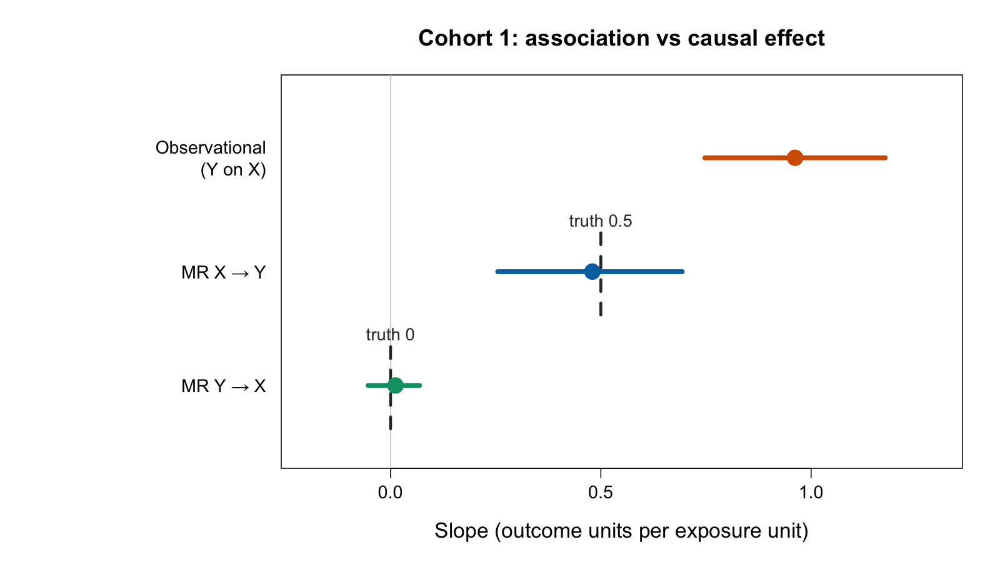

# Mendelian randomization in Diversity Outbred mice with qtl2mr

[](https://github.com/XDai-bris/qtl2mr-tutorial/actions/workflows/replay.yml)
[](#licence)

**CTC 2026 workshop · 45 minutes · hands-on in R**



*In simulated Diversity Outbred mice, the association between X and Y (top) is well above the true causal effect (0.875 against 0.5). Mendelian randomization recovers the effect of X on Y (middle) and finds no sign of an effect of Y on X (bottom). Dashed lines: the truth built into the simulation.*

Two traits move together in your mice. Does X drive Y, does Y drive X, or does something else move both? This workshop shows how Mendelian randomization (MR) uses the random inheritance of founder alleles to tell cause from association, with [qtl2mr](https://github.com/XDai-bris/qtl2mr-uvmr) and simulated mice where we know the right answer.

## Quick start

1. Install [R](https://cran.r-project.org/) (4.1 or newer) and [RStudio Desktop](https://posit.co/download/rstudio-desktop/).
2. Click **Code → Download ZIP** above and unzip it, or run `git clone https://github.com/XDai-bris/qtl2mr-tutorial`.
3. Open `qtl2mr-tutorial.Rproj` in RStudio and follow the guide, starting with Task 01.

## Open the guide

**<https://xdai-bris.github.io/qtl2mr-tutorial/>**

The same guide is `docs/index.html` in the downloaded folder; it works offline. Copy each code box into the RStudio Console, in order, in the same R session. The guide shows the Console output and figures you should see.

## Workshop at a glance

| Part | What happens | Minutes |
|---|---|---:|
| Before class | Install R and RStudio, download this repository, run Task 01 | pre-work |
| Opening | Two traits move together: which drives which? The MR diagram and its three assumptions | 4 |
| 0 Meet the simulated world | Three cohorts (400, 500 and 700 mice) from one simulated population with a known truth (Task 02) | 3 |
| 1 Correlation is not causation | The association vs MR in both directions, in one cohort (Task 03) | 14 |
| 2 Two-sample MR | X and Y measured in different mice (Task 04) | 12 |
| 3 Built on qtl2's founder model | Your qtl2 objects are qtl2mr's inputs; a QTL is an eight-founder pattern, not two alleles (no code) | 8 |
| Take-home | Three points, one per part, and further steps | 4 |
| | **Total** | **45** |

The presenter runs the code live; you are welcome to follow along. There is no in-class debugging, so please set up before the workshop.

## Before the workshop

Please set up at home, because conference Wi-Fi can be slow:

1. Install R and RStudio Desktop (see Quick start).
2. Download or clone this repository. On Windows, keep the folder outside OneDrive or Dropbox, because synced folders often block package installation.
3. Open `qtl2mr-tutorial.Rproj` and run Task 01 from the guide once. It installs qtl2mr from the `package/` folder into a private `library/` folder inside this project, so nothing else on your computer changes. It needs an internet connection once, to download the small `fs` package from CRAN. On Linux, `fs` is built from source and needs libuv (`libuv1-dev` on Debian and Ubuntu).

You are ready when Task 01 ends with *"Milestone 1: qtl2mr 0.6.0 is loaded and a results folder is ready."* If Task 01 fails in class, keep watching: the guide shows every output.

## What is in this repository

| Path | Contents |
|---|---|
| `docs/index.html` | The guide (also online, see above) |
| `qtl2mr-tutorial.Rproj` | RStudio project; open this first |
| `tasks/` | The four tasks, one R file each, with the code shown in the guide |
| `workshop.R` | All four tasks in one script |
| `R/` | Set-up and helper code used by the tasks (`install.R`, `setup.R`, `display.R`, `mr_helpers.R`, `plots.R`) |
| `data/` | Simulated teaching data: `cohort1.rds` (400 mice, X and Y), `cohortA.rds` (500 mice, X only), `cohortB.rds` (700 mice, Y only); three non-overlapping samples of one simulated DO population |
| `data/simulation/` | How the simulated data were made: the code, with a README that explains each step |
| `package/qtl2mr_0.6.0.tar.gz` | The qtl2mr release used by this tutorial |
| `reference/` | The Console output and figures you should expect |
| `.github/` | Automatic check that the tasks run on Windows, macOS and Linux |

## About the qtl2mr version

The tutorial is fixed to **qtl2mr 0.6.0**, so that your output matches the guide. The bundled archive is identical to the [official 0.6.0 release](https://github.com/XDai-bris/qtl2mr-uvmr/releases/tag/v0.6.0); its SHA256 is

```
b12cb5df26b70e7b4bc0cb65d757efbd435270c8216c1d393f7f3985ceb75197  package/qtl2mr_0.6.0.tar.gz
```

The `library/` folder created by Task 01 belongs to this project only. For your own analyses, install the latest release from [XDai-bris/qtl2mr-uvmr](https://github.com/XDai-bris/qtl2mr-uvmr). The tasks switch off some slower qtl2mr options to keep the workshop short; the guide notes which.

## Tested on

macOS on Apple silicon with R 4.6.2. On every change, GitHub also runs all four tasks automatically on Windows, macOS and Linux, and with R 4.1 on Linux, and compares their Console output with `reference/console/`; the **replay** badge above shows the latest result. The last decimal place of some numbers may differ between computers.

## Licence

- **Code** (R scripts, including the simulation code in `data/simulation/`; RStudio project; the scripts in `.github/`) is licensed under [GPL-3](LICENSE), the same licence as qtl2mr.
- **Guide, figures, reference output and simulated data** are licensed under [CC BY 4.0](LICENSE-MATERIALS.md).

## Contact

Xiaoyang Dai, University of Bristol: <x.dai@bristol.ac.uk>. Questions and problems are welcome as [GitHub issues](https://github.com/XDai-bris/qtl2mr-tutorial/issues); please paste the error message.

All data in this repository are simulated, so we know the true answers and can check what the methods find. Genotypes were simulated with [simcross](https://CRAN.R-project.org/package=simcross) and traits with [qtl2founderSim](https://github.com/XDai-bris/qtl2founderSim); the code is in [`data/simulation/`](data/simulation/). No real mice or real traits are involved.

<sub>Extended study: a longer two-hour version of this tutorial is available at <https://github.com/XDai-bris/qtl2mr-tutorial/tree/extended-2h>.</sub>
