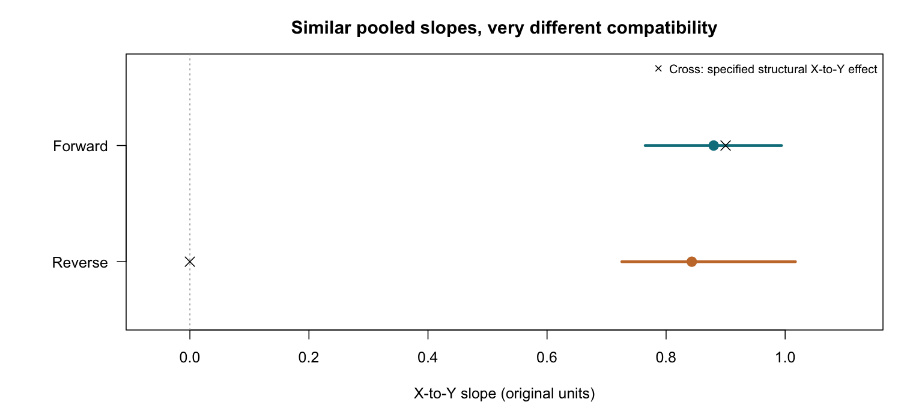

# qtl2mr tutorial: Mendelian randomization in Diversity Outbred mice

[](https://github.com/XDai-bris/qtl2mr-tutorial/actions/workflows/replay.yml)
[](#licence)

Hands-on materials for the qtl2mr workshop at the 23rd Complex Trait Community meeting: the **CTC 2026 edition**. Follow them at your own pace, before, during or after the workshop.



*Two simulated datasets give similar positive X → Y slopes, but in one of them X has no effect on Y (Y drives X instead). The diagnostics in this tutorial flag the difference; they do not prove which is right.*

Your mouse cohort shows two traits that move together. Does one drive the other, does the arrow point the other way, or is something else behind both? Mendelian randomization (MR) uses the random inheritance of alleles as a natural experiment to help answer that, and [qtl2mr](https://github.com/XDai-bris/qtl2mr-uvmr) does it for Diversity Outbred (DO) mice using the eight founder haplotypes at each QTL.

## Quick start

1. Install [R](https://cran.r-project.org/) (4.1.0 or newer) and [RStudio Desktop](https://posit.co/download/rstudio-desktop/).
2. Click **Code → Download ZIP** above and unzip it, or run `git clone https://github.com/XDai-bris/qtl2mr-tutorial.git`.
3. Open `qtl2mr-tutorial.Rproj` in RStudio and follow the guide, starting with Task 01.

## Open the guide

**<https://xdai-bris.github.io/qtl2mr-tutorial/>**

You can also open `docs/index.html` from the downloaded folder. Paste the code into the RStudio Console task by task, in order, in the same R session. Your results, figures and reports are saved under `results/`.

## Workshop at a glance

| Task | What you do | Minutes |
|---|---|---|
| — | Why MR in mice? How the guide works | 5 |
| 01 | Check the installation and the built-in example | 5 |
| 02 | Meet one X–Y pair: 400 mice, founder probabilities, kinship | 10 |
| 03 | Choose instruments: regional peaks, then a founder-strength (F) check | 15 |
| 04 | Run MR on the Forward data and read its diagnostics | 20 |
| 05 | Repeat on the Reverse data, where the true X → Y effect is zero | 5 |
| 06 | Steiger direction diagnostic (SF), partial R², and a manual sensitivity IV set | 15 |
| 07 | Case A: three exposures in one batch, compared with observational slopes | 15 |
| 08 | Case B: why the founder pattern matters | 15 |
| 09 | Save results and locate an estimate and Q | 3 |
| — | Take-home discussion | 2 |
| | Questions and recovery | 10 |
| | **Total** | **120** |

The timetable includes the introduction and closing. Expanded mathematics, the glossary and *After the workshop* are for self-study; they are not extra live lectures. The 120 minutes are a teaching budget, not measured participant completion time.

Learn how to choose QTL instruments, run founder-based MR, and interpret direction and founder-pattern diagnostics. The tutorial then extends to three exposures and compares MR with observational associations.

## Before the workshop

Please set up at home, because conference Wi-Fi can be slow:

1. Install R and RStudio Desktop (see Quick start).
2. Download or clone this repository. On Windows, put the folder somewhere outside OneDrive or Dropbox, for example `C:\Users\<you>\qtl2mr-tutorial-main`, because synced folders often block package installation.
3. Open `qtl2mr-tutorial.Rproj` and run Task 01 from the guide once. It installs qtl2mr from the `package/` folder into a private `library/` folder inside this project, so nothing else on your computer changes. It needs an internet connection once, to download the small `fs` package from CRAN. On Linux, `fs` is built from source: it needs C build tools and lists libuv as a system requirement (`libuv1-dev` on Debian and Ubuntu).

If Task 01 ends with *"Milestone 1: qtl2mr 0.6.0 is loaded and the example plot is visible."*, you are ready. In class, Task 01 is then a 5-minute check.

## What is in this repository

| Path | Contents |
|---|---|
| `docs/index.html` | The step-by-step guide (also online, see above) |
| `qtl2mr-tutorial.Rproj` | RStudio project; open this first |
| `tasks/` | The nine tasks, one R file each, with the code shown in the guide |
| `workshop.R` | All nine tasks in one script |
| `R/` | Set-up and helper code used by the tasks (`install.R`, `setup.R`, `display.R`, `workshop_helpers.R`) |
| `data/` | Simulated teaching data: a 400-mouse X–Y pair with two QTL scans, Case A and Case B. `forward_instruments.csv` and `reverse_instruments.csv` are an answer key: the instrument tables that Tasks 03 and 05 produce |
| `package/qtl2mr_0.6.0.tar.gz` | The qtl2mr release used by this tutorial |
| `reference/` | Console output, figures and tables you should expect |
| `.github/` | Automatic check that the tasks run on Windows, macOS and Linux |

## About the qtl2mr version

The tutorial is fixed to **qtl2mr 0.6.0** so that your output matches the guide. The bundled archive is identical to the [official 0.6.0 release](https://github.com/XDai-bris/qtl2mr-uvmr/releases/tag/v0.6.0); its SHA256 is

```
b12cb5df26b70e7b4bc0cb65d757efbd435270c8216c1d393f7f3985ceb75197  package/qtl2mr_0.6.0.tar.gz
```

The `library/` folder created by Task 01 belongs to this project only. For your own analyses, install the latest release from [XDai-bris/qtl2mr-uvmr](https://github.com/XDai-bris/qtl2mr-uvmr). The tutorial uses some settings chosen for speed that differ from the package defaults; the guide's *After the workshop* section lists them.

## Tested on

macOS on Apple silicon with R 4.5.3 and R 4.6.1. The same nine tasks also run automatically on GitHub, on Windows, macOS and Linux (R release, and R 4.1 on Linux), and their Console output is compared with `reference/console/`; the **replay** badge above shows the latest result. The last decimal place of some numbers may differ between computers.

<details>
<summary>Maintaining this tutorial</summary>

This repository is the sole maintained source for the tutorial: edit `docs/index.html` here, keep its code aligned with `tasks/`, and keep its embedded figures identical to `reference/figures/`. The earlier v0.7 `build_guide.py` and its `repo/` staging copy are retired historical material; do not use them to regenerate or replace this guide. Any future builder must first reproduce the current guide without losing its content.

Coordinate one editor at a time and hand over the commit and working-tree status before another editor starts. Keep qtl2mr 0.6.0, teaching data and numerical analysis results unchanged unless a separate update is explicitly agreed.

</details>

## Licence

- **Code** (R scripts, RStudio project, the scripts in `.github/`) is licensed under [GPL-3](LICENSE), the same licence as qtl2mr.
- **Guide, figures, reference output and simulated data** are licensed under [CC BY 4.0](LICENSE-MATERIALS.md).

## Contact

Xiaoyang Dai, University of Bristol: <x.dai@bristol.ac.uk>. Questions and problems are welcome as [GitHub issues](https://github.com/XDai-bris/qtl2mr-tutorial/issues); please paste the error message.

All data in this repository are simulated, so we know the true answers and can check what the methods find. No real mice or real traits are involved.
